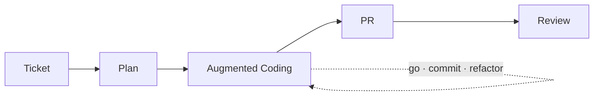

* TOC
{:toc}

# 증강 코딩 운영 기록

개인 프로젝트에서 검증한 증강 코딩을 팀에 적용하면서, 사람이 방향과 판정 기준을 정하고 AI가 그 안에서 작업하도록 운영해왔다. 그 과정에서 바뀐 작업 방식과 판단 기준을 남긴다.

---

## 1) 시작점

처음에는 바이브 코딩과 AI에 작업을 전면 위임하는 방식에 회의적이었다. 명령을 바꿔도 결과물이 계속 마음에 들지 않았고, 코드 품질도 일정하지 않았다. 무엇보다 결과가 우리 업무 맥락에 맞는지 확신하기 어려웠다. 돌아보면 그때는 AI에게 한 번에 너무 많은 것을 요구하기도 했다.

생각이 바뀐 계기는 Kent Beck의 글이었다. 코드 품질을 중요하게 보던 사람이 AI를 적극적으로 쓰되, 자기 기준에 맞춰 운영 방식을 만드는 모습이 인상적이었다.

- <https://tidyfirst.substack.com/p/augmented-coding-beyond-the-vibes>

그때부터 역할을 나눴다. 사람은 방향을 정하고 설계와 판정 기준을 책임진다. AI는 그 기준 안에서 작업한다. 이 방식이 통하는지 확인하려고 팀에 적용하기 전 개인 프로젝트에서 약 2주간 먼저 검증했다.

- <https://github.com/currenjin/alexandria-playground/tree/main/playground-augmented-coding>

개인 검증에서는 티켓을 기준으로 작업할 때 재현성이 높아졌고, 테스트 루프를 강제했을 때 속도와 안정성을 함께 얻을 수 있었다. 프롬프트를 잘 쓰는 감각보다 작업 순서와 검증 구조가 결과를 더 크게 좌우했다.

---

## 2) 팀 적용 방식

팀에서는 다음 순서로 작업한다.

1. Jira 티켓을 읽고 `plan.md`를 만든다.
2. `plan.md`를 기준으로 구현한다.
3. 테스트를 통과할 때까지 수정 루프를 반복한다.
4. PR을 생성하고 리뷰 단계로 이동한다.

### 운영 흐름 다이어그램

처음에는 개인적으로 사용했지만, 효과를 확인한 팀원들이 사용하기 시작했다. 구현 결과가 그럴듯해 보이는지만으로 판단하지 않고, 테스트를 기준으로 실행과 수정을 반복했다. 그 과정에서 작업 안정성과 구현·검증 속도가 나아졌고, 리뷰 전 단계의 품질 편차도 줄었다.

---

## 3) 운영 방식이 바뀐 지점

처음부터 하네스라는 단어를 의식한 것은 아니었다. 작업 순서와 검증 절차를 쌓다 보니, AI의 실행을 제어하는 하네스 구조가 됐다.

현재 사용하는 스킬은 다음과 같다.

- `jira-to-plan`
- `augmented-coding`
- `push-pr`
- `review`
- `work` (통합 실행)

사람은 목표와 제약, 완료 기준을 정한다. AI는 구현과 수정, 반복 실행을 맡는다. 리뷰에서는 자동 리뷰 결과와 사람의 판단을 함께 사용한다.

팀에서는 AI를 작업자로 두고 운영하기 시작했다. 작업자로 본다는 것은 작업 결과를 보고하고, 수정을 반영하며, 기준을 충족할 때까지 반복하도록 명시적으로 요구한다는 뜻이다.

---

## 4) 증강 코딩의 철학

우리는 사람이 설계하고 AI가 작성하는 방식으로 운영한다. 여기서 설계에는 아이디어뿐 아니라 문제 정의와 제약, 완료 기준과 검증 기준까지 포함된다. 이 기준을 먼저 정하지 않으면 AI가 빠르게 구현하더라도 의도한 방향에서 벗어날 수 있다.

### 4-1) augmented coding은 vibe coding이 아니다

vibe coding은 “일단 돌아가면 된다”에 가까운 접근이다. 반면 augmented coding에서는 동작 여부와 함께 코드 구조, 테스트 신뢰도, 복잡도 변화도 살핀다.

결과가 좋기를 기대하는 데서 멈추지 않고, 정한 기준을 충족할 때까지 검증과 수정을 반복한다. 두 방식을 운영할 때의 차이는 생성 능력보다 결과를 판정하는 기준이 있는지에 있다.

### 4-2) 기능 속도만 올리면 복잡도가 먼저 쌓인다

AI로 기능을 빠르게 추가하더라도 구조 정리가 따라오지 못하면 복잡도가 쌓인다. 어느 시점부터는 변경 비용이 급격히 올라가 다음 기능을 구현하는 속도까지 떨어뜨린다.

Kent Beck의 관점으로 보면 features와 options의 균형이 깨지는 상황이다. 기능은 늘지만 이후에 바꿀 수 있는 선택지, 즉 변경 가능성과 구조 유연성이 줄어든다. 다음 기능에서도 속도 이점을 유지하려면 구현하는 동안 구조를 정리하는 과정도 넣어야 한다.

### 4-3) TDD는 설계를 방해하는 게 아니라 설계를 드러내는 방식이다

TDD를 테스트 작성 규칙으로만 보면 설계에 쓰이는 역할을 놓치기 쉽다. 작은 테스트로 설계 판단을 드러내고, 일반화가 필요한 시점과 범위를 좁게 통제할 수 있다.

테스트가 많다는 것만으로는 부족하다. 테스트를 판정 기준으로 삼고, 구현과 리팩터링 모두 그 기준을 따르도록 해야 한다. 그러면 설계 판단이 어긋났을 때 테스트로 확인하고 작은 범위에서 되돌릴 수 있다.

### 4-4) 책임은 사람에게 남는다

AI가 코드를 작성해도 다음 판단은 사람이 맡는다.

- 도메인 정책 적합성
- 요구사항 충족 여부
- 장기 유지보수 관점의 구조와 가독성
- 코드리뷰 최종 승인

AI가 작업했다는 이유로 이 판단과 책임까지 넘길 수는 없다. 경계가 흐려지면 단기적으로 작업 속도가 올라가더라도 품질과 신뢰가 함께 무너진다.

### 4-5) 컨텍스트는 넓게 주는 것보다 정확히 잘라 주는 게 낫다

AI에게 전체 맥락을 한 번에 주는 편이 좋을 것 같지만, 실제로는 반대인 경우가 많았다. 목표 범위를 좁히고 다음 한 단계에 필요한 맥락을 명확히 줬을 때 품질이 더 일정했다.

컨텍스트가 과도하면 요청하지 않은 기능을 미리 추가하거나 과잉 추론으로 흐를 가능성이 커진다. 그래서 전체 비전과 현재 실행할 단위를 분리해서 전달한다.

### 4-6) 복잡도는 부채가 아니라 운영 지표다

복잡도를 나중에 한꺼번에 정리할 대상으로 미뤄두지 않는다. 구현하는 동안 복잡도가 얼마나 빠르게 늘어나는지도 살핀다.

우리는 구현량과 함께 리뷰 피로도, 재작업률, 테스트 수정 비용을 본다. 많이 만들었더라도 계속 바꾸기 어려워졌다면 다음 작업에서 그 비용을 치르게 되기 때문이다.

### 4-7) AI 실패는 결과가 아니라 신호에서 먼저 보인다

AI가 작업에 실패하기 전, 다음과 같은 행동이 먼저 나타나는 경우가 많다.

- 같은 수정 루프를 반복한다.
- 요청하지 않은 기능을 계속 확장한다.
- 테스트를 우회하거나 약화하려 한다.
- 설명은 그럴듯하지만 diff 품질이 떨어진다.

이 신호가 보이면 프롬프트를 더 길게 쓰기보다 작업 범위를 줄이고 판정 기준을 다시 정하는 편이 효과적이다.

### 4-8) 자동화는 실행량을 늘리고, 사람은 판단 밀도를 높인다

생성, 수정, 테스트처럼 반복하는 작업은 자동화하고, 정책과 우선순위 해석, 품질 승인은 사람이 맡는다. 반복 실행에 쓰던 에너지를 판단에 남겨두려는 분담이다.

이렇게 역할을 나누면 속도와 품질을 함께 높일 수 있다. 반대로 판단까지 자동화하려 하면 잘못된 방향으로 빠르게 진행할 가능성이 커진다.

### 4-9) 결론: 증강 코딩은 모델 문제가 아니라 운영 설계 문제다

모델이 좋아질수록 성능 차이는 줄어들 수 있다. 그때도 운영에서는 다음 질문이 남는다.

- 누가 방향을 정하는가.
- 어떤 기준으로 멈추고 고치는가.
- 누가 최종 책임을 지는가.

우리가 증강 코딩에서 지키려는 것은 기술에 대한 낙관이나 비관보다, 속도를 높이면서도 판단과 책임을 놓지 않는 운영 방식이다.

---

## 5) 자동화 경계

현재 자동화 우선순위는 다음과 같다.

- Jira 티켓 읽기와 작업 시작
- Planning을 기준으로 PRD 초안을 만들고 Story와 Task로 분해하기
- 구현과 테스트 루프 반복 실행

다음 영역은 전면 자동화할 때 위험이 따른다.

- 코드리뷰 최종 판단
- 도메인과 요구사항 해석의 충돌
- 조직 합의가 필요한 프로세스 변경

---

## 6) 현재 팀 이슈

이 기록을 정리하는 시점의 팀 병목은 리뷰 속도보다 리뷰 품질에 가깝다. CodeRabbit과 `/review`를 적용해도 도메인에 맞는지 판단하고, 요구사항 누락이나 해석 오류를 확인하는 문제는 남는다.

이 문제의 상당수는 Jira 티켓 자체가 부정확하거나 필요한 내용이 빠진 상태에서 시작할 때 발생한다. 기획 프로세스를 자동화하는 실험(idea → planning → event storming → PRD)에도 기술 문제뿐 아니라 조직 합의가 필요한 문제가 있다.

---

## 7) 현재 결론

아직 운영 방식이 완성됐다고 보지는 않는다. 다만 지금까지는 모델 선택보다 운영 설계가 결과를 더 크게 좌우했고, 개인의 프롬프트 실력보다 팀 하네스가 결과를 안정시켰다. 생성량을 늘리는 것보다 의도를 정하고 검증하는 루프를 다듬는 쪽에 무게를 두고 있다.

---

## 8) 개인 측정 사례 (2026-05)

증강 코딩 도입 전후의 개인 git 활동을 같은 길이의 기간(약 113일)으로 비교했다. 한 사람, 한 저장소(roouty-backend)의 데이터이므로 일반화할 근거로 삼지는 않는다. 운영 설계 변경이 개인 작업 패턴에 어떻게 드러났는지 보여주는 사례로 본다.

### 8-1) 비교 기간

- 이전: 2025-10-01 ~ 2026-01-20
- 이후: 2026-01-21 ~ 2026-05-14 (`augmented-coding` 스킬 도입일 기준)

### 8-2) 수치

| 지표 | 이전 | 이후 | 변화 |
|---|---:|---:|---:|
| 본인 커밋 수 | 171 | 170 | ≈ |
| 머지된 PR (squash 기준) | 145 | 151 | +4% |
| 활동일수 | 43일 | 52일 | +21% |
| 총 변경 라인 | 20,594 | 115,272 | 5.6x |
| 파일 변경 횟수 | 846 | 1,900 | 2.2x |
| 라인/일 평균 | 479 | 2,217 | 4.6x |
| 라인/커밋 평균 | 120 | 678 | 5.6x |

### 8-3) 패턴 변화

- PR 수는 거의 같지만 PR당 변경 규모는 5.6배로 늘었다. 더 큰 단위의 작업을 한 번에 내보내는 패턴이다.
- 20시 이후 야간 커밋 비중은 26%에서 6%로 줄었다. 업무시간 안에서 처리량을 늘렸다.
- 커밋 타입 분포도 달라졌다.
  - 이전: `fix` 41, `feat` 8. `fix`가 `feat`의 5배로, 사후 대응 위주였다.
  - 이후: `fix` 17, `feat` 3, `chore` 6, `test` 3, `refactor` 2.
  - `fix`의 절대 수는 절반 이하로 줄었고, `test`와 `refactor`가 별도 타입으로 등장했다. 구현 중 구조를 정리한다는 4-2)의 원칙과 같은 방향의 변화다.

### 8-4) 해석 시 유의점

- 라인 수는 노력의 대용지표이며 코드 품질을 직접 말해주지는 않는다. PR 수가 비슷한데 라인이 5배라는 것은 작업 단위가 커졌다는 신호 정도로만 본다.
- 도입 후 기간에는 `auto`, `handoff`, `work` 같은 다른 스킬도 함께 정착했다. 이 변화를 `augmented-coding` 단독 효과로 볼 수는 없으며, AI 보조 워크플로 전체의 효과로 해석한다.
- 팀 구성, 도메인 난이도, 처리한 티켓 성격 같은 외부 변수는 보정하지 않았다.

### 8-5) 정리

라인/일과 변경 파일 수로 본 실행량은 자동화 이후 늘었다. 야간 커밋이 줄고 테스트와 리팩터링 커밋이 등장한 것은 사람 쪽 운영의 변화로 본다. 다만 1인 사례이므로 생성 능력과 운영 설계 각각의 효과를 입증한 것은 아니다. 판정 체계와 운영 설계에 무게를 둔 4-8), 4-9)의 가설과 같은 방향으로 해석한다.
